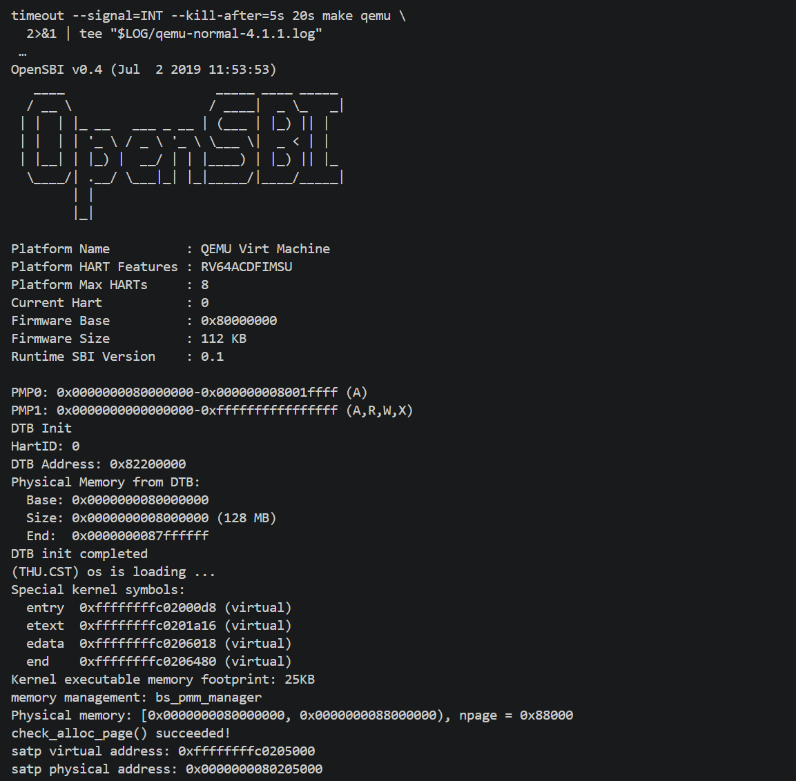
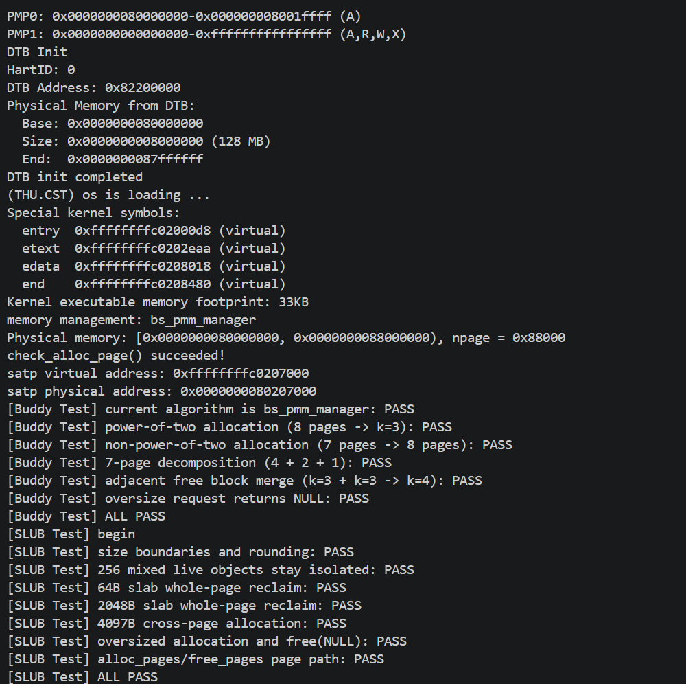
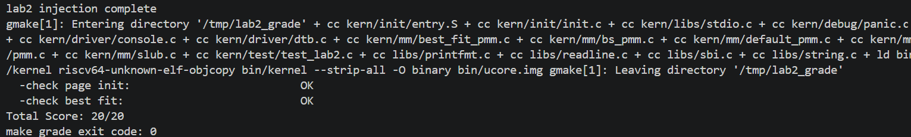

# 南开大学 2026 年操作系统实验报告

## 实验基本信息

| 项目 | 内容 |
| --- | --- |
| 实验名称 | Lab2：物理内存和页表 |
| 小组成员与学号 | 焦宇堃、徐夏茗、黄国天（2411557） |
| 完成日期 | 2026.10.23 |
| 提交仓库与最终提交号 | [小组仓库](https://github.com/ghub1821239/NKU2026-OS-Group_34/tree/lab2)，分支 `lab2`；基准提交 `7281d3b` |

### 小组分工

实现与验证分工：

| 成员 | 负责的练习或功能模块 | 负责的验证工作 |
| --- | --- | --- |
| 黄国天 | 功能模块一：DTB 内存信息获取与 `page_init()` 物理页初始化 | 核对物理内存范围、`Page` 数组位置、保留页及初始空闲页数，检查 Page Init 评分结果 |
| 焦宇堃 | 功能模块二：First-Fit 分析、Best-Fit 与 Buddy 页面分配算法 | 验证 Best-Fit 选块断言，以及 Buddy 的取整分配、空闲区拆分、伙伴合并和计数恢复 |
| 徐夏茗 | 功能模块三：SLUB 小对象分配；页表与 QEMU 调试分支 | 验证 SLUB 对象隔离与整页回收，观察 Sv39 地址转换及 TLB 查询、回填与命中 |

报告分工：

| 成员 | 负责的报告部分 |
| --- | --- |
| 黄国天 | 实验目的、环境与整体链路；4.1 物理内存初始化；5.1～5.2 基础知识及对应 Spec、Prompt 与验证说明 |
| 焦宇堃 | 4.2 页面分配算法；4.5 构建与测试结果；5.3 分配策略比较及对应 Spec、Prompt 与问题修复 |
| 徐夏茗 | 4.3 SLUB；4.4 页表与地址转换；5.4 尚未涉及的知识点；5.5 AI 协作经验汇总 |

AI 编程工具与模型使用情况：

| 成员 | AI 编程工具 | 底层模型及版本 |
| --- | --- | --- |
| 黄国天 | Codex | GPT-6.1 Sol |
| 徐夏茗 | Codex | GPT-6.1 Sol |
| 焦宇堃 | Claude Code | DeepSeek-V4-Flash |

---

## 一、实验目的

1. **理解页表的建立和使用方法：** 从启动汇编中的静态页表入手，掌握 SV39 的虚拟地址划分、页表项结构与 `satp` 寄存器配置，理解内核如何通过高虚拟地址访问物理内存。
2. **理解物理内存的管理方法：** 解析设备树提供的物理内存信息，在内核末尾建立物理页描述符数组，排除固件、内核镜像及描述符数组自身占用的空间，将剩余的完整空闲页注册到内存管理器。
3. **理解页面分配算法：** 在分析 First-Fit 算法的基础上，实现 Best-Fit 与 Buddy System 页面分配器，掌握连续物理页的分配、拆分、释放与合并机制，并通过 SLUB 扩展任务理解底层页分配与上层小对象分配的层次关系。

Lab1 中的内核具备了基本的启动和串口输出能力。Lab2 以此为基础继续解决三个问题：

1. 内核如何得到物理内存的范围并区分可用与已占用页面。
2. 分配器如何按不同粒度实现内存申请与回收。
3. 物理页面如何通过虚拟地址映射被内核正常访问。

## 二、实验环境

本次实验的编译、运行与测试均在 Ubuntu 环境下完成，具体软件与硬件模拟参数如下：

| 项目 | 环境参数 |
| --- | --- |
| 操作系统 | Ubuntu 22.04.5 LTS |
| 目标架构 | RISC-V 64 位 |
| 交叉编译器 | riscv64-unknown-elf-gcc 10.2.0 |
| 模拟器与固件 | QEMU 4.1.1、OpenSBI v0.4 |
| 调试器 | GNU gdb 12.1 |
| 构建与脚本工具 | GNU Make 4.3、Python 3.10.12 |
| 模拟平台与物理内存 | QEMU virt，128 MiB |
| 页大小 | 4096B，PGSHIFT=12 |
| 内核镜像装载地址 | 物理地址 0x80200000 |
| 内核链接起始地址 | 虚拟地址 0xffffffffc0200000 |
| 内核直接映射偏移 | 0xffffffff40000000 |
| Git 基准提交号 | 7281d3bcbd9fd42a6c63c611e436e6e2cc9aa4c4 |

主机环境、工具链版本与提交记录见 [environment.log](records/environment.log)，运行状态见[普通启动日志](records/qemu-normal-4.1.1.log)。

## 三、实验整体逻辑分析

### 3.1 本章节的逻辑主线

操作系统的物理内存管理的第一项依赖是一个可正常运行的虚拟地址环境。内核入口汇编 `entry.S` 先保存 OpenSBI 传入的硬件线程号与设备树物理地址，配置好静态启动页表并开启分页，再跳转到高虚拟地址空间执行 C 语言初始化函数。这样一来，内核后续代码就可以直接通过固定偏移量访问设备树和全部物理内存。

进入 `kern_init()` 后，`dtb_init()` 从设备树中提取物理内存的起始地址与大小。此时内核虽然知道了机器拥有多少物理内存，但还不能直接分配使用。接下来的 `page_init()` 负责在内核镜像末尾建立 `Page` 描述符数组，为每个物理页建立元数据记录单元：先将所有物理页统一标记为保留状态，再把内核镜像和描述符数组之后的完整空闲物理页交由内存管理器接管。

有了空闲页区间后，页面分配算法正式开始工作。First-Fit、Best-Fit 和 Buddy 都通过统一的 `pmm_manager` 接口管理连续物理页，主要区别在组织空闲链表和挑选空闲块的策略上。SLUB 分配器构建在页面分配器之上，将单个物理页进一步切分为多个小对象槽位，避免几十字节的小内存请求独占整页。最后，通过内置自检函数、外部扩展测试以及官方评分脚本验证各模块的正确性。

内核从启动到完成内存管理检查的完整调用流程如下：

```text
kern_entry：保存 hartid、DTB 地址，配置启动页表和内核栈
    ↓
kern_init：清零 BSS → dtb_init → 控制台及内核信息输出
    ↓
pmm_init
    ├─ init_pmm_manager → 初始化所选页分配器的空闲管理结构
    ├─ slub_init        → 初始化对象缓存结构，此时尚不申请物理页
    ├─ page_init        → 建立 Page 数组 → 调用 init_memmap 注册空闲页
    ├─ check_alloc_page → 调用所选管理器的 check 自检函数
    └─ 打印启动根页表的虚拟地址和物理地址
    ↓
测试构建：执行 test_buddy_system → slub_check
    ↓
内核进入无限循环
```

### 3.2 功能的逐步实现

| 阶段 | 主要函数或入口 | 所在文件 | 为后续阶段提供的条件 |
| --- | --- | --- | --- |
| 启动映射 | `kern_entry` | [kern/init/entry.S](../code/kern/init/entry.S) | 建立高地址直接映射，使内核和设备树可通过高虚拟地址访问 |
| 内存信息获取 | `dtb_init`、`get_memory_base`、`get_memory_size` | [kern/driver/dtb.c](../code/kern/driver/dtb.c) | 提供物理内存的起始地址和总长度 |
| 描述符及空闲区建立 | `page_init`、`init_memmap` | [kern/mm/pmm.c](../code/kern/mm/pmm.c) | 建立 `Page` 数组，区分保留页与可分配的完整空闲页 |
| 连续页管理：First-Fit | `default_*` | [kern/mm/default_pmm.c](../code/kern/mm/default_pmm.c) | 按首次适应策略分配、拆分、释放和合并连续物理页 |
| 连续页管理：Best-Fit | `best_fit_*` | [kern/mm/best_fit_pmm.c](../code/kern/mm/best_fit_pmm.c) | 选择满足申请的最小空闲块，并维护拆分与合并 |
| 连续页管理：Buddy | `bs_*` | [kern/mm/bs_pmm.c](../code/kern/mm/bs_pmm.c) | 按幂次块分级管理，通过二分和伙伴合并申请、回收物理页 |
| 小对象管理 | `slub_init`、`slub_alloc`、`slub_free` | [kern/mm/slub.c](../code/kern/mm/slub.c) | 按字节粒度分配对象，底层按需申请或归还整页 |
| 内置自检入口 | `check_alloc_page` → `pmm_manager->check` | [kern/mm/pmm.c](../code/kern/mm/pmm.c) | 调用所选分配器中的 `default_check`、`best_fit_check` 或 `bs_check` |
| Buddy 外部测试 | `test_buddy_system` | [tools/bs_test_lab2.c](../code/tools/bs_test_lab2.c) | 检查幂次分配、非幂次请求、空闲区拆分和伙伴合并 |
| SLUB 外部测试 | `slub_check` | [tools/slub_test_lab2.c](../code/tools/slub_test_lab2.c) | 检查尺寸分流、对象隔离、跨页访问和整页回收 |
| 课程评分 | `make grade`、`test_page_init`、`test_best_fit` | [Makefile](../code/Makefile)、[tools/grade.sh](../code/tools/grade.sh)、[tools/test_lab2.c](../code/tools/test_lab2.c) | 构建评分镜像，验证物理页初始化与 Best-Fit 管理器选择 |

其中，`default_check()`、`best_fit_check()`、`bs_check()` 分别定义在上表对应的三个页分配器文件中。

在 `pmm_init()` 的执行顺序中，初始化管理结构与注册可用页面是分开的两步：`init_pmm_manager()` 先将空闲链表置空，`slub_init()` 也只初始化各尺寸档位的缓存头，直到 `page_init()` 调用 `init_memmap()` 后，分配器内部才真正拥有可分配的物理页。这种顺序保证了在内存布局尚未划定前，不会有任何模块误用物理页面。

实验开发过程以阅读理解 First-Fit 为起点，接着实现 Best-Fit，随后完成必做扩展任务 Buddy System，最后实现 Challenge 任务 SLUB 分配器与未知物理内存探测分析。在构建配置上，日常运行与扩展测试默认使用 Buddy + SLUB，运行官方评分脚本时则通过编译宏切换为 Best-Fit。

## 四、实验内容与实现

### 4.1 功能模块一：物理内存初始化

#### 4.1.1 任务目标与规格设计

本模块的目标是实现 [pmm.c](../code/kern/mm/pmm.c) 中的 `static void page_init(void)`，根据设备树探测结果建立 `Page` 描述符数组，并将可用的空闲物理页注册给页面分配器。

在编写 Prompt 前，我们先梳理了该函数的接口与状态约束：明确 `npage` 表示物理页号上界、`nbase` 表示 DRAM 起始物理页号，虚实地址满足 `vaddr = paddr + va_pa_offset`；要求只实现 `page_init()` 函数体。

正确的函数执行需完成 `pages`、`npage` 和 `va_pa_offset` 的赋值，将固件、内核镜像与 `Page` 数组自身占用的页面设置为保留状态，仅将按页对齐后的完整空闲页传入 `init_memmap()`。若设备树内存前缀不等于 `DRAM_BASE`、长度为 0 或末端计算溢出，则触发 `panic`；描述符数组放不下时同样终止。若布局完成后没有完整空闲页，则直接返回而不调用 `init_memmap()`。预先明确页数、物理页号与描述符虚拟地址之间的换算关系，有效避免了 AI 生成代码时混淆物理地址与虚拟地址。完整 Prompt 见[小组提示词：物理页初始化](prompt.md)。

#### 4.1.2 从 DTB 取得物理内存信息

在 [entry.S](../code/kern/init/entry.S) 入口处，OpenSBI 通过 `a0` 和 `a1` 寄存器传入当前硬件线程号与 DTB 的物理地址，汇编代码将它们分别存入全局变量 `boot_hartid` 和 `boot_dtb`。进入 C 代码后，`dtb_init()` 将 `boot_dtb` 加上 `PHYSICAL_MEMORY_OFFSET` 转换为内核虚拟地址进行访问。

[dtb.c](../code/kern/driver/dtb.c) 先校验 DTB 地址非空以及头部固定前缀 `0xd00dfeed`，随后调用 `extract_memory_info()` 扫描设备树结构块，定位 `memory` 节点的 `reg` 属性，将前两个 64 位大端整数解析为物理内存起始地址 `memory_base` 和长度 `memory_size`，并通过 `get_memory_base()` 与 `get_memory_size()` 暴露给 `page_init()`。在本次 128 MiB 配置下，解析出的内存起点为 `0x80000000`，长度为 `0x08000000`，对应半开物理地址区间 `[0x80000000, 0x88000000)`。当前解析器针对 QEMU virt 平台做了简化，主要读取单段连续 RAM 的起止范围。DTB 输出中的末字节地址 `0x87ffffff` 与 PMM 输出的半开区间末端 `0x88000000` 描述同一范围。

#### 4.1.3 页号、描述符与虚实地址换算

`Page` 描述符数组本身存放在内核镜像末尾的内存中，它描述的对象是从 `DRAM_BASE` 开始的每一个 4 KiB 物理页帧。[pmm.h](../code/kern/mm/pmm.h) 中定义的换算内联函数如下：

```c
static inline ppn_t page2ppn(struct Page *page) {
    return page - pages + nbase;
}

static inline uintptr_t page2pa(struct Page *page) {
    return page2ppn(page) << PGSHIFT;
}
```

其中 `nbase` 是物理内存起点 `0x80000000` 对应的起始物理页号，而 `npage` 是受管理物理内存末端对应的物理页号上界，二者的差值才是实际管理的物理页总数。在 128 MiB 内存下，相关数值关系如下：

```text
nbase = 0x80000000 >> 12 = 0x80000
npage = 0x88000000 >> 12 = 0x88000
描述符个数 = npage - nbase = 0x8000 = 32768
```

由物理地址反查描述符时，内联函数 `pa2page(pa)` 通过 `&pages[PPN(pa) - nbase]` 计算对应结构体指针，页内低 12 位偏移在右移时被自然舍去。宏 `PADDR(kva)` 则利用内核直接映射区的线性关系，直接将内核虚拟地址减去 `va_pa_offset` 得到物理地址。这一换算适用于本实验的内核直接映射区；`pa2page()` 的调用者还应保证物理地址不低于 DRAM 起点。

#### 4.1.4 `page_init` 的实现过程

`page_init()` 首先调用 `get_memory_base()` 和 `get_memory_size()` 获取物理内存范围，检查起点是否为 `DRAM_BASE`、长度是否非零，以及起点与长度相加是否溢出，信息无效时触发 `panic`。接着设置 `va_pa_offset = PHYSICAL_MEMORY_OFFSET`，将物理内存末端限制在内核最大支持上界 `PHYSICAL_MEMORY_END` 以内，并计算物理页号上界 `npage`。

随后，代码将 `pages` 数组放置在内核结束符号 `end` 之后向上按页对齐的位置。写入前先确认整个数组能放进受管理内存，再将全部描述符初始化为保留页：

```c
npage = PPN(mem_end);
extern char end[];
pages = (struct Page *)ROUNDUP((uintptr_t)end, PGSIZE);

size_t nr_pages = npage - nbase;
uintptr_t pages_pa = PADDR(pages);
uintptr_t managed_end = ROUNDDOWN(mem_end, PGSIZE);
if (pages_pa >= managed_end ||
    nr_pages > (managed_end - pages_pa) / sizeof(*pages)) {
    panic("page_init: not enough memory for Page descriptors");
}
for (size_t i = 0; i < nr_pages; i++) {
    pages[i].ref = 0;
    pages[i].flags = 0;
    pages[i].property = 0;
    SetPageReserved(&pages[i]);
}
```

这里采用先全部置为 `PG_reserved`、再单独开放安全空闲区间的策略。这样一来，`[0x80000000, 0x80200000)` 的 OpenSBI 固件区、`[0x80200000, PADDR(end))` 的内核代码数据段，以及紧随其后的 `pages` 描述符数组自身占用的物理页都会自然保持保留状态，防止分配器将正在存放管理元数据的页面分配出去。

接下来计算真正可供分配的空闲物理内存起止地址：

```c
uintptr_t free_start_pa =
    PADDR(ROUNDUP((uintptr_t)(pages + nr_pages), PGSIZE));
uintptr_t free_end_pa = ROUNDDOWN(mem_end, PGSIZE);
```

`pages + nr_pages` 通过结构体指针加法跨过整个描述符数组，向上按页对齐后再由 `PADDR` 转为物理地址，作为空闲区的起点 `free_start_pa`；内存末端向下按页对齐得到 `free_end_pa`，确保交给分配器的全部是完整的 4 KiB 页面。当 `free_start_pa < free_end_pa` 时，调用 `init_memmap()` 完成注册：

```c
init_memmap(pa2page(free_start_pa),
            (free_end_pa - free_start_pa) / PGSIZE);
```

`init_memmap()` 内部会进一步调用当前 `pmm_manager->init_memmap`，由具体的分配器负责清除这批页面的 `PG_reserved` 标志并挂入空闲链表。至于位于 `0x82200000` 的 DTB 区域，由于所需内存信息已在 `dtb_init()` 中提取完毕，后续将其纳入空闲区复用不会影响内核运行。

#### 4.1.5 Challenge：OS 如何获取未知的可用物理内存范围

在未知硬件环境上，操作系统通常依靠固件传递标准化硬件描述或调用固件查询接口来获取物理内存布局。例如在本实验的 QEMU virt 平台上，QEMU 创建描述模拟硬件的设备树，OpenSBI 通过 `a1` 寄存器把 DTB 地址传给内核；在 x86 BIOS 或 UEFI 平台上，引导程序则会通过 `int 0x15` 的 `e820` 中断或 UEFI `GetMemoryMap` 接口获取内存映射表。

操作系统在拿到物理内存范围后，还必须严格区分物理上存在的 RAM 与实际可供分配的空闲 RAM。某段属于 DRAM 的地址，其中也可能驻留着固件代码、内核镜像、设备树、启动栈或硬件保留区。因此，完整的物理内存初始化流程应当先解析全部可用 RAM 段与 `reserved-memory` 保留节点，再剔除内核自身与页描述符数组占用的区间，最后按页对齐，将剩余的完整物理页分段注册到物理内存管理器中。如果脱离固件描述去盲目读写未知物理地址，极易误触外设 MMIO 寄存器导致系统异常，因此不能作为通用的内存探测方案。

### 4.2 功能模块二：物理内存分配

#### 4.2.1 核心数据结构与统一接口

[memlayout.h](../code/kern/mm/memlayout.h) 定义了物理页描述符与空闲区结构：

```c
struct Page {
    int ref;
    uint64_t flags;
    unsigned int property;
    list_entry_t page_link;
};

typedef struct {
    list_entry_t free_list;
    unsigned int nr_free;
} free_area_t;
```

每个 `Page` 结构体包含引用计数 `ref`、状态标志 `flags`、连续空闲页数 `property` 以及双向链表节点 `page_link`。其中 `PG_reserved` 表示页面被保留不可分配；`PG_property` 标识一个连续空闲块的头页，其 `property` 字段记录该空闲块包含的连续物理页数。对于一个包含多页的空闲块，只有头页会设置 `PG_property` 并挂入空闲链表，块内的其余页面虽然也是空闲的，但它们的 `PG_property` 位为 0，也不直接出现在链表上。因此，单凭 `PG_property` 为 0 无法判断一页是否已经分配，还需要结合它所属的块理解。

为了支持不同的分配算法，框架通过 `pmm_manager` 结构体封装了一组函数指针，包括 `init`、`init_memmap`、`alloc_pages`、`free_pages`、`nr_free_pages` 和 `check`。上层调用 `alloc_pages()` 或 `free_pages()` 时无需关心底层细节，只需切换 `pmm_manager` 指针即可替换具体的页面分配策略。

链表操作依托 [libs/list.h](../code/libs/list.h) 实现的带头节点循环双向链表。空链表头的 `prev` 和 `next` 均指向自身，遍历链表时以再次回到头节点作为终止条件。由于链表节点 `page_link` 嵌在 `struct Page` 内部，遍历时通过 `le2page(le, page_link)` 宏计算结构体成员偏移，即可从链表节点指针反推出对应的 `Page` 结构体指针。`list_add()` 在指定节点之后插入，`list_add_before()` 在之前插入；遍历时先排除表头哨兵，再将节点转换为 `Page`。

#### 4.2.2 First-Fit：从初始化到释放合并

框架自带的 [default_pmm.c](../code/kern/mm/default_pmm.c) 实现了 First-Fit 算法，为我们后续编写 Best-Fit 提供了参考模板。本任务以理解已有算法为主，小组没有单独的 First-Fit 代码生成 Prompt。

1. **初始化与建链：** `default_init()` 将 `free_list` 初始化为空环，并将空闲总页数 `nr_free` 置 0。`default_init_memmap(base, n)` 接收一段连续物理页，先清除每一页的 `flags` 和引用计数，接着在头页 `base` 上设置 `base->property = n` 并置位 `PG_property`，将 `nr_free` 增加 `n`，最后按页面地址从小到大的顺序把 `base->page_link` 插入 `free_list`。
2. **首次适应分配：** `default_alloc_pages(n)` 在确认 `n <= nr_free` 后，从链表头开始按地址升序扫描，找到第一个满足 `p->property >= n` 的空闲块即停止搜索。将该块头页从链表摘除后，如果原块大小大于 `n`，就把剩余部分的头页 `page + n` 的 `property` 设为 `page->property - n`，置位 `PG_property` 并插回原链表位置；最后将 `nr_free` 减去 `n`，清除分配块头页的 `PG_property` 并返回。
3. **释放与相邻合并：** `default_free_pages(base, n)` 先重置这 `n` 个页面的状态，把 `base` 重新设为大小为 `n` 的空闲块头页并按地址升序插回链表，同时将 `nr_free` 增加 `n`。随后检查链表中的前驱节点与后继节点是否在物理地址上与之紧邻：若前驱块满足 `p + p->property == base`，则将当前块并入前驱块，累加 `property`，清除 `base` 的 `PG_property` 并将其从链表摘除，同时令 `base = p`；接着再用更新后的 `base` 检查后继块是否满足 `base + base->property == p`，若满足则同样向后合并。由于合并的页面已经在前面计入了 `nr_free`，合并过程只减少链表中的块节点数，不改变空闲总页数。

这里的 `Page` 指针加法按描述符元素数移动：`page + n` 对应后移 n 个物理页，物理地址相差 `n × PGSIZE`。

##### 源码缺陷：`default_free_pages()` 尾插分支缺少 `break`

**问题位置：** `default_pmm.c` 中 `default_free_pages()` 的 `else if (list_next(le) == &free_list)` 分支。当前源码在执行尾插后缺少 `break`。

**触发条件与后果：** 空闲链表非空，且新释放块 `base` 的地址大于所有已有空闲块。尾插完成后，下一轮循环会访问刚插入的 `base->page_link`，再次进入尾插分支，把该节点插入自身之后。按本实验 `list_add()` 的实现，这会使节点的 `prev` 指向自身，破坏双向链表。后续 `list_del()` 无法正确摘除该块，可能造成同一物理页被重复分配。

**修正方式：** 尾插完成后立即退出查找循环：

```c
} else if (list_next(le) == &free_list) {
    list_add(le, &(base->page_link));
    break;
}
```

**复核结果：** 使用项目中的 `list.h` 构造一个低地址已有块和一个高地址待释放块。缺少 `break` 时，新节点的 `prev` 指向自身，删除后仍留在链表中；在最小复现中补上 `break` 后，前后指针及节点删除结果均正确。

**思考题：First-Fit 是否有改进空间？**

从算法策略来看，First-Fit 每次都从低地址头部开始线性扫描，容易在低地址区域积聚大量难以利用的外部小碎片，拉长后续查找时间，最坏时间复杂度为 $O(m)$。改进方向可以采用记录上次扫描位置的 Next-Fit 策略减少重复扫描，或按大小分桶缩小搜索范围；若维护按块长排序的平衡树，可将选块查找降至 $O(\log m)$。

#### 4.2.3 Best-Fit：规格设计与最小充分块选择

Best-Fit 任务要求补全 [best_fit_pmm.c](../code/kern/mm/best_fit_pmm.c) 中的 `best_fit_init`、`best_fit_init_memmap`、`best_fit_alloc_pages`、`best_fit_free_pages` 和 `best_fit_nr_free_pages`，并导出 `best_fit_pmm_manager` 结构体。

在设计规格与 Prompt 时，我们明确要求保持 `free_area`、`free_list` 和 `nr_free` 的定义不变，不修改框架自带的 `basic_check()` 与 `best_fit_check()`，因为测试函数会直接备份和校验内部的链表结构与计数器。同时规定：链表按地址升序维护；尾插分支必须包含 `break`；当请求页数大于 `nr_free` 或遍历后找不到足够大的连续块时返回 `NULL`，且不改动原有链表状态。完整 Prompt 见[小组提示词：Best-Fit](prompt.md)。

Best-Fit 与 First-Fit 的核心差异集中在 `best_fit_alloc_pages()` 的选块循环中：

```c
// best_fit_alloc_pages 中的候选更新逻辑
if (p->property >= n) {
    if (page == NULL || p->property < page->property) {
        page = p;
    }
}
```

区别于原始实现遇到第一个满足条件的块就 `break`，这里完整扫描整条空闲链表，持续维护一个满足 `p->property >= n` 且 `property` 最小的候选块指针 `page`。当遇到多个大小相同的候选块时，由于判断条件使用的是严格小于号 `<`，算法会保留最先遇到的低地址空闲块。

选定最佳块之后，块分裂、链表更新与 `best_fit_free_pages()` 中的按地址插入及前后相邻块合并逻辑，均与前面分析的地址有序链表维护规则保持一致。若原块有 m 页、请求 n 页，则低地址 n 页交给调用者，`page + n` 成为长度为 `m - n` 的余块首页，空闲计数只扣除 n。

#### 4.2.4 `best_fit_check` 如何区分两种算法

为了验证实现的是真正的 Best-Fit 而非 First-Fit，框架在 `best_fit_check()` 中构造了一个特征测试场景：先申请 5 个连续页 `p0`，隔离原有空闲链表后，依次释放 `p0 + 1` 处的 2 个页和 `p0 + 4` 处的 1 个页：

```c
free_pages(p0 + 1, 2);
free_pages(p0 + 4, 1);
assert(alloc_pages(4) == NULL);
assert(PageProperty(p0 + 1) && p0[1].property == 2);
assert((p1 = alloc_pages(1)) != NULL);
assert(alloc_pages(2) != NULL);
assert(p0 + 4 == p1);
```

此时空闲链表中按地址从低到高依次挂着一个 2 页块（`p0 + 1`）和一个 1 页块（`p0 + 4`）。接下来调用 `alloc_pages(1)` 申请 1 页：如果是 First-Fit，它会直接切分排在前面的 2 页块，导致后续的 `alloc_pages(2)` 因缺少连续 2 页而失败；而 Best-Fit 会挑出后面大小恰好为 1 页的 `p0 + 4`，把完整的 2 页块保留下来，从而让紧接着的 `alloc_pages(2)` 顺利通过，且满足 `p0 + 4 == p1`。

`basic_check()` 还检查单页分配唯一性、初始引用状态、空表申请失败与页面复用；`best_fit_check()` 最后恢复原空闲区并核对块数和页数。评分中的 `test_best_fit()` 核对管理器指针，具体分配行为由前面执行的管理器自检覆盖。

**思考题：Best-Fit 是否有改进空间？**

当前实现每次分配都会完整遍历整条空闲链表，最坏和平均查找时间复杂度均为 $O(m)$。首先，可以在循环中加入精确匹配提前退出逻辑：一旦发现 `p->property == n`，说明已经找到不可能更小的理想块，直接 `break` 即可。其次，线性链表无法兼顾按大小快速查找和按地址快速合并，如果将空闲块同时组织在一棵按块大小排序的红黑树或平衡二叉树中，就能将选块时间降到对数级。此外，Best-Fit 倾向于切出极其微小的剩余碎片，在实际系统中可以结合下限阈值，当剩余碎片过小时直接整块分配，并记录实际占用长度供释放时使用，减少无用碎片的产生。

#### 4.2.5 Buddy System：分级空闲链表与初始化分解

Buddy System 伙伴分配器位于 [bs_pmm.c](../code/kern/mm/bs_pmm.c)，对应实现与测试的两份 Prompt 见[小组提示词：Buddy 及测试](prompt.md)。

伙伴系统定义了长度为 `BS_MAX_ORDER`（32）的 `free_area` 数组，第 $k$ 阶（$0 \le k < 32$）的空闲链表专门管理大小为 $2^k$ 页、且起始物理页号按 $2^k$ 对齐的连续物理页块。各阶的 `nr_free` 同样按包含的物理页总数统计，`bs_nr_free_pages()` 通过累加全部 32 个阶的 `nr_free` 返回系统当前总空闲页数。

在 `bs_init_memmap(base, n)` 注册初始空闲区时，传入的连续页数 `n` 通常不是 2 的幂，起始物理页号也未必满足高阶对齐要求。因此，代码从当前未处理的起始页号 `ppn + done` 出发，在剩余页数 `avail` 允许且满足地址对齐的前提下，贪心找出当前能切出的最大阶数 `order`：

```c
while (order + 1 < BS_MAX_ORDER
       && (1UL << (order + 1)) <= avail
       && (((ppn + done) & ((1UL << (order + 1)) - 1)) == 0)) {
    order ++;
}
```

每次切出一个 $2^{\text{order}}$ 页的块后，将其头页的 `property` 设为块大小、置位 `PG_property`，挂入第 `order` 阶空闲链表，再把已处理页数 `done` 向前推进 $2^{\text{order}}$ 页，循环直至全部 `n` 页拆分完毕。例如一段起始地址按 8 页对齐、长度为 7 页的空闲区，会被依次拆分为 4 页、2 页和 1 页三个块，分别放入第 2、1、0 阶链表。严格保证每个块的起始页号按块大小对齐，是后续释放时能够直接使用异或运算定位伙伴块的前提。

#### 4.2.6 Buddy System：向上取整、逐级分裂与异或合并

当调用 `bs_alloc_pages(n)` 申请 $n$ 页时，辅助函数 `bs_order(n)` 先计算出满足 $2^k \ge n$ 的最小阶数 $k$。随后从第 $k$ 阶开始向上扫描，找到第一个非空的阶 `cur`。将该阶的空闲块从链表摘除并扣减对应计数后，若 `cur > k`，则通过循环将其逐级对半分裂：每次将高地址半块作为新的空闲块挂入 `cur - 1` 阶链表并累加该阶计数，低地址半块则继续向下分裂，直到块大小缩减为 $2^k$ 页后返回给调用者。若从目标阶到最高阶都没有可用块，则返回 `NULL`。

这里需要区分初始化空闲区与申请内存两种不同操作：把 7 页的初始空闲区交给 `bs_init_memmap()` 会拆成 `4 + 2 + 1` 三个块；而调用 `bs_alloc_pages(7)` 申请 7 页时，为了返回一段连续的物理内存，分配器会将请求向上取整，直接分配一个完整的 8 页块，多出的 1 页即为伙伴系统的内部碎片。

释放内存时，`bs_free_pages(base, n)` 同样先根据 `n` 计算出实际占用的阶数 $k$ 与块大小 `size = 1UL << k`，清理这 `size` 个页面的状态后，利用异或运算循环查找并合并伙伴块：

```c
size_t buddy_ppn = page2ppn(base) ^ size;
if (buddy_ppn < nbase || buddy_ppn >= npage) {
    break;
}
struct Page *buddy = pages + (buddy_ppn - nbase);
if (!PageProperty(buddy) || buddy->property != size) {
    break;
}
```

只有当计算出的 `buddy_ppn` 落在有效管理范围内，且对应的 `buddy` 页面正处于空闲块头页状态（`PageProperty(buddy)` 为真）并具有相同的块大小 `size` 时，才说明伙伴块完全空闲且同阶。此时将伙伴块从当前阶链表摘除，取二者中地址较低者作为新头页，清除地址较高者的 `PG_property` 标志，将阶数加 1、块大小翻倍，继续向上一层尝试递归合并；直到无法合并时，再将最终合成的大块一次性挂入对应阶的空闲链表。伙伴是同一个父块的两个半块，物理相邻且大小相同还不足以确定伙伴关系；释放时也要使用与原申请一致的页数约定。

#### 4.2.7 Buddy 的测试设计

Buddy 的验证分为内置自检 `bs_check()` 与外部测试 [bs_test_lab2.c](../code/tools/bs_test_lab2.c) 两部分：

* **内置自检 `bs_check()`：** 先遍历全部 32 阶链表，核对每个空闲块的对齐属性、块大小与总页数统计；接着依次申请 5、3、1 页，验证空闲页数准确扣减了 `8 + 4 + 1 = 13` 页；释放后不仅检查总空闲页数恢复，还逐阶比对空闲块数量是否完全复原，确保伙伴合并真正生效。自检还对 1～16 页请求进行往返分配，并验证多个单页同时占用后的释放恢复。
* **外部扩展测试 `bs_test_lab2.c`：** 专门构造了 6 项针对性测试，包括检查当前管理器名称为 `bs_pmm_manager`、8 页幂次申请与对齐验证、7 页非幂次请求向上取整占用 8 页验证、将对齐的 8 页块取出前 7 页重新建图以验证 `4 + 2 + 1` 拆分逻辑、两个 8 页伙伴块按不同顺序释放后合并回 16 页块，以及超额申请返回 `NULL`。拆分测试结束后会取回各子块并整体释放，恢复测试前的空闲状态。

### 4.3 扩展任务：SLUB 小对象分配器

#### 4.3.1 两层架构与规格设计

底层页分配器以 4 KiB 页为最小分配单位，直接用来分配几十字节的内核数据结构会造成严重的内部碎片。为此，我们在 [slub.c](../code/kern/mm/slub.c) 中实现了构建在物理页分配器之上的 SLUB 小对象分配层。相关实现与测试 Prompt 见[小组提示词：SLUB 及测试](prompt.md)。

SLUB 采用两级分流设计：

* **小对象分配（1B ~ 2048B）：** 预设 8、16、32、64、128、256、512、1024、2048 字节共 9 个尺寸档位。申请大小不超过 2048 字节时，向上取整匹配到最近的尺寸档，从该档位的单页 slab 中切分对象。由于 64 位 RISC-V 架构下指针占 8 字节，最小档位设为 8 字节刚好可以在空闲对象内部直接存放单向链表的 `next` 指针。
* **大对象分配（> 2048B）：** 超过 2048 字节的请求直接按 4 KiB 页向上取整，转发给底层 `pmm_manager->alloc_pages()` 分配整页。

#### 4.3.2 Slab 创建与 `Page` 元数据复用

`slub_init()` 在启动时初始化 9 个尺寸档的缓存描述符，计算出每页可容纳的对象个数 `objs_per_slab = PGSIZE / obj_size`，此时并不预先申请物理页。当某个尺寸档首次收到分配请求且可用 slab 链表为空时，`slub_new_slab()` 直接调用 `pmm_manager->alloc_pages(1)` 向底层申请一页物理内存。直接调用底层管理器可以避免再次经过公共 `alloc_pages()` 和 SLUB 分流而形成递归。

为了不在物理页内部额外消耗空间存放管理头部，SLUB 直接复用了该页对应的 `struct Page` 描述符字段：`flags` 记录 SLUB 页面标记与所属尺寸档下标，`ref` 记录当前页内剩余的空闲对象数量，`property` 记录空闲对象单向链表头部的槽位索引，`page_link` 则将该 slab 页挂入所属尺寸档的可用链表。这样一来，一页 4096 字节的内存可以全部用来切分对象，例如 64B 档位一页恰好容纳 64 个对象。

新申请的物理页通过内核虚拟地址划分为连续的固定大小槽位，并在每个槽位开头写入下一个槽位的地址，构造出页内空闲对象单向链表：

```c
for (size_t i = 0; i < cache->objs_per_slab; i ++) {
    void *obj = base + i * cache->obj_size;
    *(void **)obj = (i + 1 < cache->objs_per_slab)
                        ? (void *)(base + (i + 1) * cache->obj_size)
                        : NULL;
}
```

当槽位处于空闲状态时，其前 8 字节存放下一空闲对象的指针；一旦分配给调用者，这 8 字节即可由调用者任意覆写使用；直到对象被释放归还时，SLUB 才会重新在其中写入链表指针。

#### 4.3.3 对象申请、释放与整页回收

调用 `slub_alloc(size)` 申请小对象时，先找到对应尺寸档链表中的第一个非满 slab 页，根据页描述符的 `property` 索引定位头对象，读取对象内部保存的 `next` 指针更新 `property`，并将空闲计数 `ref` 减 1。如果分配后 `ref` 变为 0，说明该 slab 页已被分配满，立即将其从可用 slab 链表中摘除，避免后续分配扫描满页。

调用 `slub_free(ptr)` 释放内存时，先对 `ptr == NULL` 做安全返回处理，再通过 `slub_kva_to_page()` 找到所属物理页的 `Page` 描述符，其换算为 `pa2page((uintptr_t)ptr - va_pa_offset)`：

1. **小对象释放：** 若页面带有 SLUB 标记，则进入 `slub_free_small()`，校验对象地址是否按档位大小对齐，然后将该对象压回页内空闲链表头部，并将 `ref` 加 1。若该页此前处于满载状态（原 `ref == 0`），则将其重新挂回对应档位的可用链表；若归还后 `ref == cache->objs_per_slab`，说明整页的所有对象均已空闲，立即将该页从档位链表摘除，清除 SLUB 标志，并调用 `pmm_manager->free_pages(page, 1)` 将整页退回底层物理页分配器。
2. **大对象释放：** 若页面没有 SLUB 标记，说明是超过 2048B 的按页分配对象。`slub_alloc_large()` 在分配时已将请求的页数保存在首页的 `property` 字段中，此时直接读取该长度并调用底层 `free_pages()` 即可完整回收。若底层使用 Buddy，释放时会根据记录的请求页数重新求阶，归还实际占用的整个幂次块。

此外，公共页分配接口 `alloc_pages(n)` 也被接入到了 `slub_alloc(n * PGSIZE)`。由于正整数页的字节数至少为 4096B，必然走大对象分支交由底层页分配器处理，保持了上下层接口的一致性。`alloc_pages()` 在字节换算前检查乘法溢出，大对象路径在按页取整前检查加法溢出。公共 `free_pages(base, n)` 直接调用底层管理器，使用页接口与对象接口时应分别保持申请、释放配对。

#### 4.3.4 测试设计与结果分析

SLUB 的外部测试入口 `slub_check()` 定义在 [slub_test_lab2.c](../code/tools/slub_test_lab2.c)，由测试构建链接，共设计了 7 组测试用例：

1. **尺寸边界与取档测试：** 覆盖 1B、7B、8B、9B 等档位边界以及 70B 向上匹配 128B 档、2048B 与 2049B 大小对象分流边界。
2. **256 个混合对象读写隔离：** 连续申请不同尺寸的 256 个小对象并同时驻留内存，向每个对象写入特定字节模式后再逐一校验，验证对象之间互不越界覆盖，随后按打乱的顺序全部释放。
3. **64B slab 整页回收：** 连续申请 64 个 64B 对象填满一页，再申请第 65 个对象触发第二页分配，随后分批释放并核对底层 `nr_free_pages()` 的变化，验证满页摘链与空页归还逻辑。
4. **2048B slab 整页回收：** 针对最大尺寸档（每页 2 个对象）验证跨页扩展与整页回收。
5. **4097B 跨页大对象读写：** 验证大对象分支分配 2 个连续物理页，并在跨页边界处正常读写。
6. **异常边界与空指针安全：** 验证超大字节请求返回 `NULL` 以及 `slub_free(NULL)` 安全返回。
7. **页级 API 兼容性：** 验证 `alloc_pages()` 与 `free_pages()` 正常工作，并在全部测试结束时断言系统总空闲页数与测试前完全一致。

### 4.4 页表及虚拟地址转换

#### 4.4.1 SV39 页表结构与开启分页流程

物理内存分配器负责管理物理页帧的空闲状态，而 CPU 访问内存时则需要通过页表将虚拟地址翻译为物理地址。

[mmu.h](../code/kern/mm/mmu.h) 定义了 RISC-V SV39 分页机制的相关宏。SV39 采用 39 位有效虚拟地址（高 25 位必须与第 38 位相同），由三级 9 位页表索引（`VPN[2]`、`VPN[1]`、`VPN[0]`）和低 12 位页内偏移组成。每张页表占一页 4 KiB 内存，包含 512 个 8 字节页表项（PTE）。在排除非法与保留编码后，PTE 的 `V=1` 且 `R/W/X` 全为 0 时，它是指向下一级页表的目录项；`R` 或 `X` 置位时，它是直接映射物理页的叶子项。叶子项不仅可以出现在第三级页表（映射 4 KiB 普通页），也可以出现在第二级（映射 2 MiB 大页）或第一级根页表（映射 1 GiB 特大页）。

在 [entry.S](../code/kern/init/entry.S) 中，内核开启虚拟内存的过程分为三步：

1. 将预设根页表 `boot_page_table_sv39` 的链接虚拟地址减去固定偏移 `0xffffffff40000000`，得到根页表的物理地址，再右移 12 位算出物理页号 PPN。
2. 将分页模式字段 `8 << 60`（代表 SV39）与根表 PPN 按位或，通过 `csrw satp, t0` 写入 `satp` 寄存器。
3. 执行 `sfence.vma` 刷新 TLB，随后加载高虚拟地址栈指针 `bootstacktop`，并跳转到高虚拟地址处的 `kern_init` 执行。

#### 4.4.2 根级 1 GiB 大页映射分析

本实验在 `entry.S` 中静态定义了 4 KiB 对齐的根页表 `boot_page_table_sv39`：

```asm
boot_page_table_sv39:
    .zero 8 * 2
    .quad (0x80000 << 10) | 0xcf
    .zero 8 * (511 - 3)
    .quad (0x80000 << 10) | 0xcf
```

该页表第 2 项与第 511 项都设置为 `0x200000cf`，其余项为 0。第 2 项将低地址 `[0x80000000, 0xc0000000)` 恒等映射到相同物理区间，覆盖开启分页后到跳转高地址前的过渡代码。第 511 项对应二进制索引 `111111111`，即 `VPN[2] = 511`，提供内核使用的高地址直接映射。其中物理页号 `PPN = 0x80000`（对应物理基址 `0x80000000`），低 8 位标志 `0xcf` 表示 `V`、`R`、`W`、`X`、`A`、`D` 全部置 1。

由于第 511 项位于根页表且 `R/W/X` 不全为 0，硬件 MMU 在第一级查表时就会将其识别为 1 GiB 的大大页叶子项，直接把虚拟地址的高位替换为物理基址 `0x80000000`，并拼上虚拟地址的低 30 位页内偏移合成最终的物理地址。通过这一项配置，虚拟地址区间 `[0xffffffffc0000000, 0xffffffffffffffff]` 被线性映射到物理地址区间 `[0x80000000, 0xc0000000)`，满足 `VA = PA + 0xffffffff40000000` 的固定偏移关系。例如内核入口虚拟地址 `0xffffffffc0200000` 经过翻译后恰好对应装载物理地址 `0x80200000`。

在 `pmm_init()` 末尾，内核打印出根页表的虚拟地址与物理地址：普通构建下输出 `satp virtual address: 0xffffffffc0205000`、`satp physical address: 0x0000000080205000`，二者之差恰好为 `0xffffffff40000000`。在链接了额外测试代码的测试构建镜像中，由于代码段增大，根页表位置顺延至虚拟地址 `0xffffffffc0207000`、物理地址 `0x80207000`。

#### 4.4.3 TLB 刷新与页表调试说明

CPU 内部使用快表 TLB 缓存近期完成的虚拟页号到物理页号的翻译结果。本实验在写入 `satp` 后执行 `sfence.vma`，同步地址翻译状态，使后续访问使用准备好的映射。内核启动使用的是 `entry.S` 中的这条指令，`pmm_init()` 末尾打印根表地址时没有重新建立动态页表。

双 GDB 调试分别控制客体内核和宿主 QEMU，实际命令与输出见[客体记录](../code/logs/mmu-guest.log)、[宿主记录](../code/logs/mmu-host.log)及[调试结果](../code/logs/mmu-run.log)。选取 `dtb_init()` 读取 DTB magic 的指令 `lw a5,0(a4)`，观测到：

| 项目 | 实际值 |
| --- | --- |
| 指令 PC | `0xffffffffc020028a` |
| 访问的虚拟地址 | `0xffffffffc2200000` |
| `satp` | `0x8000000000080205` |
| 根页表物理地址 | `0x80205000` |
| 根表索引与 PTE 地址 | 511，`0x80205ff8` |
| PTE | `0x200000cf` |
| 翻译得到的物理地址 | `0x82200000` |

QEMU 的慢路径从 `load_helper()` 经 `riscv_cpu_tlb_fill()` 进入 `get_physical_address()`。根表项是 1 GiB 叶子，查询在根层完成；结果与 OpenSBI 传入的 DTB 物理地址一致。随后 `tlb_set_page()` 回填软件 TLB。取指调试还分别捕获了主表冲突后的 victim TLB 恢复，以及标签匹配时的主表直接命中，记录中的 `TLB_DIRECT_HIT=0` 与 `TLB_DIRECT_HIT=1` 对应这两条路径。

### 4.5 实验验证与结果

#### 4.5.1 构建目标与测试入口

项目 [Makefile](../code/Makefile) 提供了三个不同的构建与验证入口，通过条件编译宏区分日常扩展运行与官方评分环境：

```c
#ifdef LAB2_GRADE
    pmm_manager = &best_fit_pmm_manager;
#else
    pmm_manager = &bs_pmm_manager;
#endif
```

三种运行模式的对比如下：

| 命令入口 | 编译宏与分配器配置 | 验证内容与实际结果 |
| --- | --- | --- |
| `make` / `make qemu` | 默认挂载 `bs_pmm_manager` | 正常启动内核、解析 DTB、建立 `Page` 数组并执行 `bs_check()`，输出成功 |
| `make test` | 定义 `ucore_test`，挂载 `bs_pmm_manager` 并链接外部测试文件 | 在启动自检后依次执行 Buddy 6 项测试与 SLUB 7 项测试，全部输出 `ALL PASS` |
| `make grade` | 创建临时副本并定义 `LAB2_GRADE`，挂载 `best_fit_pmm_manager` | 运行官方 `test_page_init` 与 `test_best_fit` 检验，得分 20/20 |

编译与清理日志分别保存在 [clean-normal.log](records/clean-normal.log)、[build-normal.log](records/build-normal.log) 和 [clean-test.log](records/clean-test.log) 中。

测试目标通过 `MAKECMDGOALS` 选择，执行时使用单独的 `make test`。当前普通构建输出到 `obj/bin`，测试构建输出到 `obj-test/bin-test`，分别保存带不同编译宏的目标文件；QEMU 通过 `-kernel` 装入镜像。`ucore_test` 负责接入外部测试，`LAB2_GRADE` 负责选择评分管理器。评分脚本在临时副本中运行 `inject.py`，复制课程测试、加入测试搜索路径，并在 `pmm_init()` 末尾接入 `test_page_init()` 与 `test_best_fit()`，随后构建镜像并检查串口结果。

#### 4.5.2 普通内核启动与 Buddy 内置检查

执行普通构建启动后，[普通启动日志](records/qemu-normal-4.1.1.log) 记录的关键运行参数如下：

| 观测项目 | 实际运行输出 |
| --- | --- |
| DTB 物理地址 | `0x82200000` |
| 物理内存范围 | `[0x80000000, 0x88000000)`，共 128 MiB |
| 物理页号上界 `npage` | `0x88000` |
| 当前页面分配器 | `bs_pmm_manager` |
| 内置自检输出 | `check_alloc_page() succeeded!` |
| 内核结束地址 `end` | `0xffffffffc0206480` |
| 根页表虚拟 / 物理地址 | `0xffffffffc0205000` / `0x0000000080205000` |



如图 1 所示，内核顺利完成 DTB 解析、物理页初始化与 Buddy 内置自检，并打印出根页表地址，随后进入 `kern_init()` 末尾的 `while (1)` 循环（自动化脚本通过 `timeout` 定时结束 QEMU 进程）。

#### 4.5.3 Buddy 与 SLUB 外部测试结果

执行 `make test` 后，[test.log](records/test.log) 记录了 Buddy 外部测试的 6 项结果：

| Buddy 外部测试项 | 结果 |
| --- | --- |
| 1. 检查当前管理器为 `bs_pmm_manager` | PASS |
| 2. 8 页幂次申请与地址对齐验证 | PASS |
| 3. 7 页非幂次请求向上取整占用 8 页验证 | PASS |
| 4. 7 页空闲区按对齐分解为 4 + 2 + 1 验证 | PASS |
| 5. 两个 3 阶（8 页）伙伴释放后合并为 4 阶（16 页）验证 | PASS |
| 6. 超量页请求返回 `NULL` 验证 | PASS |

紧接着执行的 SLUB 外部测试共包含 7 项检查，结果如下：

| SLUB 外部测试项 | 结果 |
| --- | --- |
| 1. 尺寸档位边界与向上取档验证 | PASS |
| 2. 256 个混合大小对象并发驻留与读写隔离验证 | PASS |
| 3. 64B slab 满载摘链与整页回收验证 | PASS |
| 4. 2048B slab 跨页扩展与整页回收验证 | PASS |
| 5. 4097B 跨页大对象读写与释放验证 | PASS |
| 6. 超量申请返回 `NULL` 与 `slub_free(NULL)` 安全验证 | PASS |
| 7. `alloc_pages` / `free_pages` 公共接口与总空闲页数恢复验证 | PASS |



如图 2 所示，Buddy 测试组与 SLUB 测试组依次输出全部子项 `PASS`，并分别打印 `[Buddy Test] ALL PASS` 和 `[SLUB Test] ALL PASS`。测试全部完成后内核进入死循环，外层 `timeout` 命令以状态码 124 正常收回 QEMU 进程。

#### 4.5.4 `make grade` 评分结果

执行 `make grade` 时，脚本自动注入官方测试代码并启用 `LAB2_GRADE` 宏编译运行，完整输出保存在 [grade.log](records/grade.log) 中：

```text
  -check page init:                         OK
  -check best fit:                          OK
Total Score: 20/20
make grade exit code: 0
```



如图 3 所示，`check page init` 和 `check best fit` 均顺利通过，拿到 20/20 满分。

`test_page_init()` 检查直接映射偏移、DTB 信息、物理页号上界、描述符位置与对齐、空闲计数、部分保留页状态，以及 `Page` 与物理地址之间的往返转换。

## 五、实验总结与收获

### 5.1 本实验重要知识点与操作系统原理的对应关系

通过本次实验，我们将操作系统原理课中的抽象概念落到了具体的 C 代码与硬件寄存器操作上。

核心知识点的对应与实现差异如下：

| 实验中的具体模块 | 对应的 OS 原理知识点 | 原理含义与实验实现的联系及差异 |
| --- | --- | --- |
| `page_init` 与 `Page` 数组 | 物理页帧管理 | 原理中用页帧表记录物理页状态；实验需先从 DTB 解析内存范围，在内核末尾建立 `Page` 数组，并手动保留固件、内核及数组自身占用的物理页 |
| Best-Fit 与 Buddy 分配器 | 连续内存分配与碎片 | 原理中分析动态分区与伙伴系统的碎片问题；实验用地址有序链表实现 Best-Fit（外部碎片），用 32 阶链表与异或寻址实现 Buddy（内部碎片），并由 `pmm_manager` 统一接口 |
| SLUB 分配器 | 内核小对象分配 | 原理中用于解决页级分配粒度过大造成的浪费；实验在页分配器之上划分 8B~2048B 九个档位，直接复用 `Page` 字段维护页内空闲单链表，省去了页内管理头开销 |
| `boot_page_table_sv39` 与 `satp` | 多级页表、大页与 TLB | 原理中介绍三级页表转换与快表加速；实验在启动阶段未建完整三级表，而是直接用 SV39 根页表叶子项建立 1 GiB 大页映射，写 `satp` 后用 `sfence.vma` 刷新 TLB |

### 5.2 物理页、`Page` 描述符与页表项 PTE 的关系

通过这次实验，我们主要搞清楚了物理页帧、`Page` 结构体和页表项 PTE 三者的区别与具体用途：

* **物理页帧**是底层真实存在的 4 KiB RAM 存储单元，用于存放代码和数据。
* **`Page` 描述符**是内核为了管理物理页帧而建立的软件账本，记录每一页是保留还是空闲、属于多大的连续块、被引用了多少次。甚至在不同层次中，同一字段还有不同用途：在底层页管理中 `ref` 表示页引用计数，而在 SLUB 层中 `ref` 被复用来统计页内剩余的空闲小对象数。
* **页表项 PTE** 则是提供给硬件 MMU 查表使用的地址翻译词条，决定某段虚拟地址映射到哪个物理页帧以及具备怎样的读写执行权限。

本实验的高地址直接映射只需根页表第 511 项这一个 1 GiB 叶子 PTE，就覆盖了全部 128 MiB 物理内存；而在软件管理层，这 128 MiB 内存依然对应着 32768 个独立的 `Page` 描述符。地址能够通过页表访问，但是很多时候该物理页处于不可分配状态，二者的分离让虚拟内存映射与物理内存分配各司其职。

### 5.3 三种页分配策略与 SLUB 的权衡对比

| 分配器 | 空闲空间组织方式 | 核心特点与碎片代价 |
| --- | --- | --- |
| First-Fit | 按地址升序排列的双向链表，取首个满足请求的块 | 实现简单，扫描可提前结束；但容易在低地址端堆积小碎片，存在外部碎片 |
| Best-Fit | 按地址升序排列的双向链表，扫描全表取最小充分块 | 尽量保留大块连续空间，但每次需全表线性扫描，且容易切出难以再利用的极小外部碎片 |
| Buddy | 按 $2^k$ 大小分为 32 阶链表，向上找块并对半分裂 | 利用对齐属性和异或运算简化分裂与合并；非幂次请求产生内部碎片，分散空闲块也可能无法满足高阶申请 |
| SLUB | 9 个固定尺寸档位（8B~2048B），页内维护空闲对象单链表 | 解决小对象直接占整页的浪费，空 slab 整页归还底层；但尺寸向上取档仍存在一定的内部碎片 |

### 5.4 OS 原理中重要但本实验尚未涉及的知识点

1. **动态页表与按需分页：** 本实验仅在启动时静态映射了 1 GiB 大页，尚未实现多级页表的动态建立与修改，也没有结合缺页异常实现按需调页。
2. **页面置换与换入换出：** 当前物理内存不足时直接返回 `NULL`，尚未实现 LRU、Clock 等页面置换算法以及磁盘交换区机制。
3. **进程地址空间隔离与写时复制：** 目前系统仅有一个内核地址空间，尚未为不同进程建立独立页表与用户态权限隔离，也未结合页引用计数实现写时复制。
4. **并发同步与每核缓存：** 当前空闲链表操作未加锁，SLUB 也未实现每 CPU 本地缓存，尚不支持多核并发环境下的安全分配。

### 5.5 Spec 编写、Prompt 设计与 AI 协作中解决的问题

在本次实验中，我们采用 `prompt / rely / guarantee / specification` 四段式结构编写提示词，完整原文见[小组提示词](prompt.md)，先明确修改的文件范围、依赖的底层宏与结构体接口、必须满足的状态不变量，再交由 AI 生成代码。

测试设计需要构造能区分策略的状态：Best-Fit 用 2 页块和 1 页块检查选择结果，Buddy 同时检查总页数与各阶结构，SLUB 同时检查对象读写隔离与底层页面回收。外部测试还需要在 `init.c` 与 Makefile 中接入，形成完整执行入口。

在实际协作与测试过程中，我们发现并解决了以下几个典型问题：

1. **扩展分配器与官方 `make grade` 评分脚本冲突**

   **问题：** 完成 Buddy 和 SLUB 后，我们将默认分配器切换为 `bs_pmm_manager` 并把 `alloc_pages()` 接入了 SLUB，结果运行 `make grade` 时官方脚本在检查管理器指针和 Best-Fit 行为时失败。

   **解决：** 分析评分脚本 `grade.sh` 与 `inject.py` 后，我们在 `pmm.c` 中引入了 `LAB2_GRADE` 条件编译宏：日常 `make qemu` 和 `make test` 默认启用 Buddy 与 SLUB；执行 `make grade` 时由脚本自动传入 `-DLAB2_GRADE` 选择 Best-Fit 管理器，SLUB 继续保留在调用链中，使功能扩展与课程评分互不干扰。

2. **Buddy 初始化拆分与分配向上取整的语义区分**

   **问题：** 早期编写 Buddy 测试 Prompt 时，笼统地写了“非 2 的幂次请求（如 7 页）自动拆分为 4+2+1”，AI 在生成测试代码时险些将 `alloc_pages(7)` 的预期行为写成分次返回三个块。

   **解决：** 我们在复核 Spec 时明确区分了两个阶段的语义：`bs_init_memmap()` 在注册一段 7 页的初始空闲区时，会将其拆分为 4、2、1 三个块挂入不同阶链表；而调用 `bs_alloc_pages(7)` 申请连续页时，必须向上取整分配一个完整的 8 页块。随后在 `bs_test_lab2.c` 中将这两点分别拆成第 3 项和第 4 项独立测试，消除了歧义。

3. **SLUB 提示词中的架构指针宽度与 2048B 边界修正**

   **问题：** 初版 SLUB Prompt 在解释最小 8B 档位时误写了“指针占 32 位”，且只写了 `< 2048B` 走小对象、`> 2048B` 走页分配，遗漏了等于 2048B 的边界情况。

   **解决：** 在结合 RV64 架构审核生成的代码时，我们确认 64 位系统下单个 `void *` 指针正好占 8 字节，因此空闲对象槽位只需存放一个 `next` 指针即刚好满足 8B 最小档位要求；同时在代码中将小对象判断条件明确为 `size <= 2048`，并在测试集中专门加入 2048B 与 2049B 的边界测试用例验证分流行为。

4. **异常输入处理约定（返回 `NULL` 与触发 `assert` 的区分）**

   **问题：** 测试 Prompt 将零大小和超量申请列为异常检查，但没有分别明确失败语义，实际框架与 AI 生成的代码对 `n == 0` 使用了 `assert(n > 0)` 直接触发 `panic` 终止内核，只有对超量申请才返回 `NULL`。

   **解决：** 如果在主测试流中直接调用 `alloc(0)` 会导致内核当场停机，无法继续执行后续测试。因此我们在完善规格说明时将“参数非法触发断言终止”与“资源不足返回 `NULL`”严格区分开，在连续运行的测试套件中重点覆盖超量申请返回 `NULL` 和 `slub_free(NULL)` 的安全恢复。
